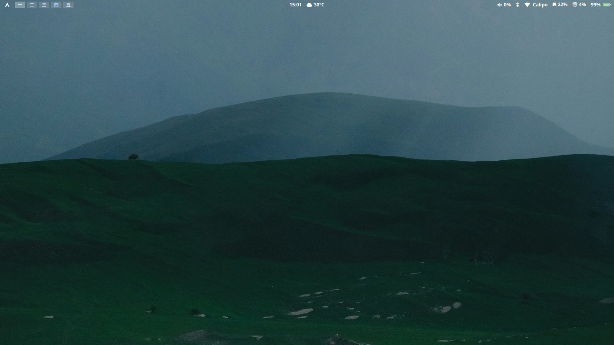

# Dotfiles de AlexG

Configuración personal para Arch Linux con Hyprland, Quickshell y Wayland.



## Contenido

- `config/hypr/` - Configuración de Hyprland (hyprland.lua, scripts)
- `config/quickshell/` - Panel, lockscreen, launcher, wallpaper picker
- `config/greeter/` - Greeter para greetd (opcional)
- `config/fontconfig/` - Configuración de fuentes
- `config/waypaper/` - Configuración de Waypaper
- `config/zsh/` - Configuración de Zsh (prompt)
- `config/fastfetch/` - Configuración de Fastfetch
- `local/bin/` - Scripts personalizados
- `wallpapers/` - Fondos de pantalla

## Instalación

```bash
git clone git@github.com:itsalexxd/calipo-s-dotfiles.git ~/01_Documents/Dotfiles
cd ~/01_Documents/Dotfiles
./install.sh
```

### Opciones

```bash
./install.sh              # Instala paquetes + crea enlaces simbólicos
./install.sh --no-pkgs    # Solo crea enlaces simbólicos (sin instalar paquetes)
./install.sh --no-zsh     # No modifica .zshrc
./install.sh --greetd     # Configura greetd + Quickshell como display manager
./install.sh --help       # Muestra ayuda
```

## Notas

- Los archivos existentes se respaldan en `~/.dotfiles-backup/FECHA-HORA/`
- Los wallpapers se enlazan a `~/02_Imagenes/Wallpapers/`
- Usa `pywal` para generar paletas de colores automáticamente
- El panel, notificaciones, lockscreen y launcher están gestionados por Quickshell
EOF
